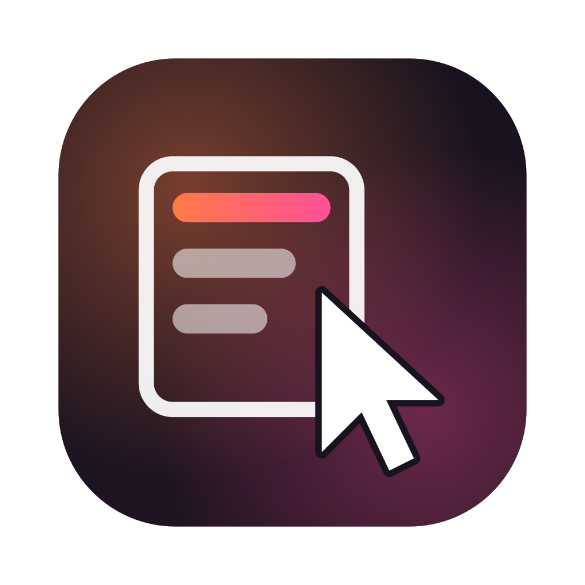
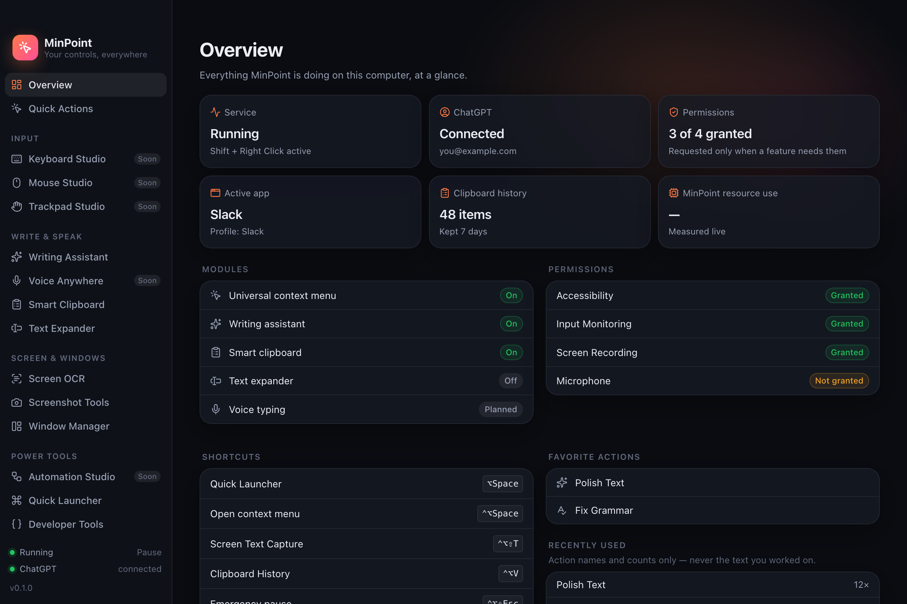
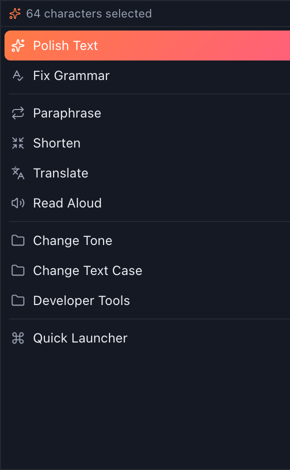
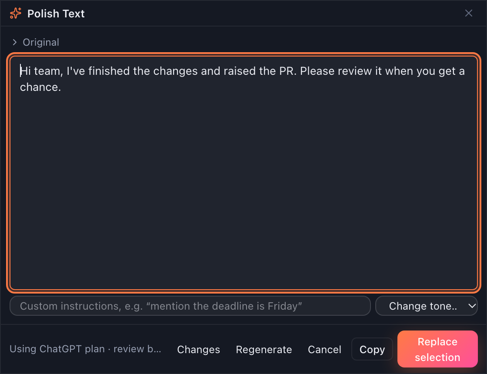
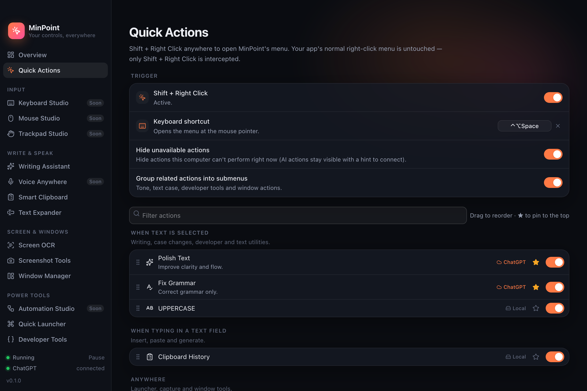
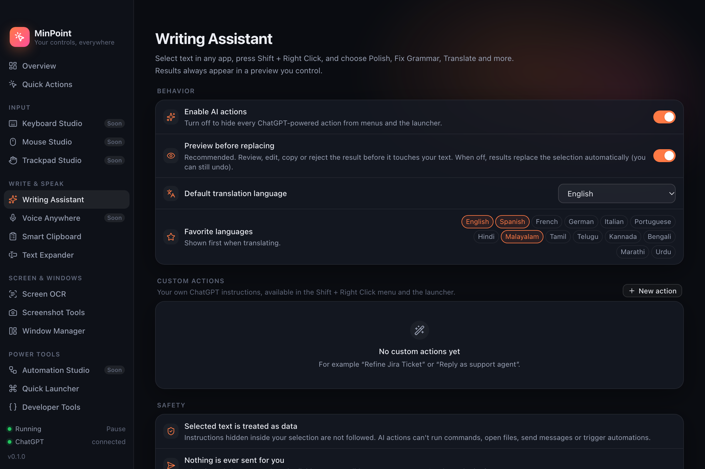
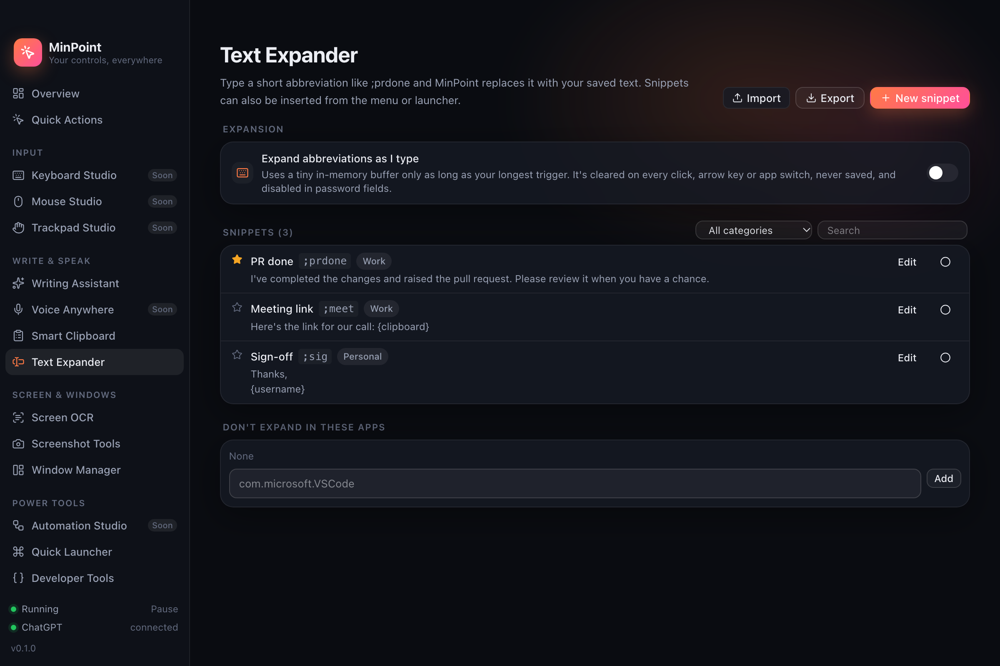
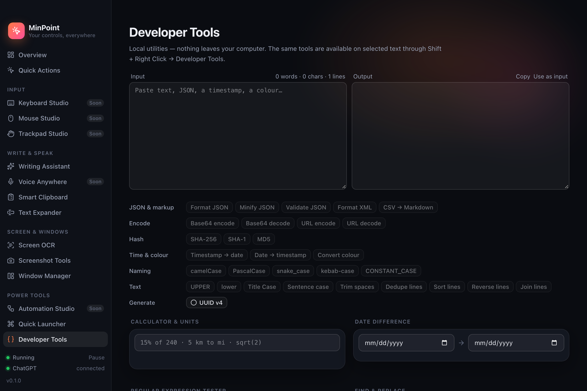
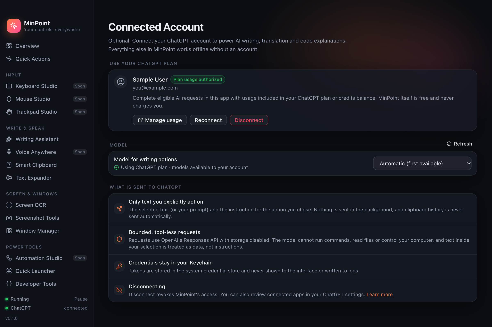
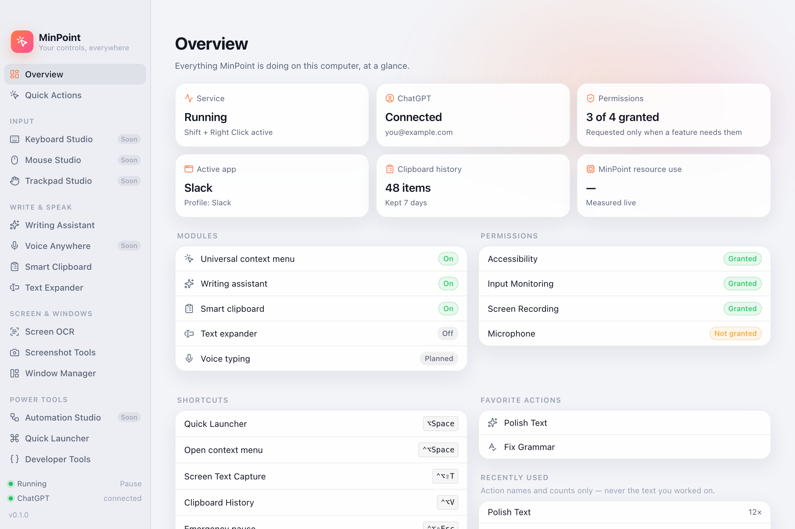

<div align="center">



# MinPoint

**Your Computer. Your Controls.**

Shift + Right Click anywhere to polish, translate or fix the text you selected, paste from a private clipboard history,<br>
expand snippets, copy text off the screen, snap windows and launch anything. All from one lightweight app.<br>
Everything runs locally. No accounts, no cloud, no subscription. ChatGPT is optional.

[](https://github.com/Binwin6724/MinPoint/releases/latest)




</div>

---

## Why MinPoint?

Most people install five or six small utilities: a clipboard manager, a text expander, a grammar helper, a window snapper, an OCR tool and a launcher. MinPoint puts them behind one gesture and stays honest about what each OS allows.

- 🖱️ **One menu, everywhere.** Hold **Shift** and right-click in any app. The menu adapts:
  - **with text selected:** writing and text tools;
  - **in a text field:** insert, paste and generate;
  - **anywhere else:** launcher, screen capture and windows.

  A normal right-click is untouched.
- ✍️ **Writing help that stays in the app you're using.** Polish, fix grammar, paraphrase, change tone, shorten, translate, summarise, explain code. Results open in a small preview with a word-level diff. **Replace** puts the result exactly where your selection was; **Copy** and **Undo** are always available.
- 🔐 **Your ChatGPT plan, not an API key.** Connect with OpenAI's official **Continue with ChatGPT** sign-in. MinPoint never sees your password, stores tokens only in the Keychain, and sends only the text you chose.
- 📋 **A private clipboard.** It's opt-in and encrypted on disk. It skips password managers and keeps only what you allow, for as long as you allow.
- ⚡ **Text expander.** Type `;prdone` and get your full message. Variables include date, time, clipboard, counters and cursor position. The buffer holds only your longest trigger's length and is never saved; it is not a keylogger.
- 🔎 **Copy anything on screen.** Drag over an image, video, slide or error dialog and get the text back. Recognition happens on this Mac with Apple Vision.
- 🪟 **Window snapping**, a **quick launcher** with calculator and unit conversion, **developer tools** (JSON, Base64, hashes, regex, timestamps, naming cases), **read aloud** with system voices, and **per-app profiles**.
- 🔒 **Private by design.** No telemetry, ads, account or servers. Everything except ChatGPT actions works offline.

## Features

| | |
|---|---|
| **Quick Actions** | Shift + Right Click menu with favorites, drag-to-reorder, submenus (tone, case, developer, windows), per-app profiles and excluded apps. Keyboard navigable. Positions itself correctly on multiple displays and scalings. |
| **Writing Assistant** | ChatGPT actions: polish, grammar, spelling, paraphrase, shorten, expand, simplify, professional, casual, friendly, formal, summarise, explain, translate, email, Slack message, technical writing, documentation, explain code or errors, improve readability, generate docs. **Custom actions** with your own instructions. **Write with ChatGPT** generates new text into the field you're typing in. The preview is the default. Focus-safe replacement never writes into the wrong app. |
| **Smart Clipboard** | Opt-in history (AES-256-GCM at rest, key in the Keychain). Search, pin, favorite and duplicate merging. Retention and size limits. App exclusions (common password managers by default). Respects nspasteboard.org *concealed* markers. A picker pastes as plain text into the previous app. |
| **Text Expander** | Abbreviations, multiline snippets, categories, favorites, per-app, case-sensitive triggers, `{date}` `{time}` `{clipboard}` `{username}` `{counter:x}` `{cursor}`. Import and export. Disabled in password fields. |
| **Screen OCR** | Select a region with the system capture tool. Text is recognised on-device by Apple Vision, then you can copy, edit, read aloud, translate or polish it. |
| **Screenshot Tools** | Area, window or full screen. Copy to the clipboard and/or save to Pictures/MinPoint. |
| **Window Manager** | Halves, quarters, maximize, center and move to next display, by shortcut or from the menu. Respects the menu bar, Dock and per-display scaling. |
| **Quick Launcher** | Apps, actions, snippets, settings, `15% of 240`, `5 km to mi`, with fuzzy search and frequently-used ranking. |
| **Developer Tools** | JSON format/minify/validate, XML, Base64, URL, SHA-256/SHA-1/MD5, UUID, timestamps, colours, CSV → Markdown, regex tester, find and replace, camel/Pascal/snake/kebab/CONSTANT case. |
| **Privacy Center** | See what's stored and what's sent. Clear history or activity, disconnect ChatGPT, export settings, delete everything. |
| **Coming next** | Voice typing (offline whisper.cpp), Keyboard/Mouse/Trackpad Studio, Automation Studio, screenshot annotation, saved window layouts. These are shown as *Soon* in the app, with honest status pages. |

## Screenshots

<table>
<tr>
<td><br><sub><b>Shift + Right Click</b>: menu for selected text</sub></td>
<td><br><sub><b>Preview</b>: edit, diff, regenerate, replace or copy</sub></td>
</tr>
<tr>
<td><br><sub><b>Quick Actions</b>: pick, order and pin menu items</sub></td>
<td><br><sub><b>Writing Assistant</b>: behaviour, languages, custom actions</sub></td>
</tr>
<tr>
<td><br><sub><b>Text Expander</b>: abbreviations with variables</sub></td>
<td><br><sub><b>Developer Tools</b>: local utilities</sub></td>
</tr>
<tr>
<td><br><sub><b>Connected Account</b>: optional ChatGPT sign-in</sub></td>
<td><br><sub><b>Light theme</b></sub></td>
</tr>
</table>

<sub>Screenshots are rendered from the app's UI with sample data (the development harness in <code>dev/</code>). The sample account and numbers are illustrative.</sub>

## Download & install

Get the installer for your computer from the **[latest release](https://github.com/Binwin6724/MinPoint/releases/latest)**:

| Computer | File |
|---|---|
| Mac with Apple silicon (M1 and later) | `MinPoint-x.y.z-mac-arm64.dmg` |
| Mac with an Intel processor | `MinPoint-x.y.z-mac-x64.dmg` |
| Windows 10 / 11 (64-bit) | `MinPoint-x.y.z-win-x64-setup.exe` |

### macOS (13 Ventura or later)
1. Open the DMG and drag **MinPoint** into **Applications**.
2. **First launch:** release builds are ad-hoc signed but not notarized. Right-click MinPoint and choose **Open**, or run:
   ```bash
   xattr -dr com.apple.quarantine /Applications/MinPoint.app
   ```
3. MinPoint lives in the **menu bar**. When you turn on a feature, it asks for the permission that feature needs:
   - **Accessibility** and **Input Monitoring** for Shift + Right Click, reading the selection and inserting text;
   - **Screen Recording** for screen text capture and screenshots.

   On managed (company) Macs these may need an administrator.

### Windows 10 / 11 (x64)
1. Run the setup file. The installer isn't code-signed yet, so SmartScreen may warn: *More info ▸ Run anyway*.
2. **Current limitation:** on Windows, this early version includes the app and its in-app tools (developer tools, calculator, snippets and settings). The system-wide menu, text insertion, OCR, clipboard history and window snapping are **macOS-only for now** and hidden on Windows. See [docs/LIMITATIONS.md](docs/LIMITATIONS.md).

### Connecting ChatGPT (optional)
Open **Connected Account ▸ Continue with ChatGPT**, sign in on OpenAI's website and allow MinPoint to use your plan. Eligible requests use your ChatGPT plan's allowance (Plus or Pro). **Manage usage** opens your ChatGPT usage settings. Disconnecting revokes access.

## How it works

```
React UI (dashboard + floating overlays)
   │  narrow, typed commands only
Rust runtime (Tauri 2): action registry · menu engine · ChatGPT auth & streaming · SQLite · shortcuts · tray
   │  PlatformAdapter
   ├─ macOS: Swift helper over stdio: CGEventTap · Accessibility · Vision · AVSpeech · NSPasteboard
   └─ Windows: adapter in progress (features hidden until implemented)
```

- **Shift + Right Click** is caught by an event tap in the helper. Only that combination is consumed; every other click passes through. If MinPoint quits or crashes, the helper exits and input is back to normal immediately.
- **Selections** are read through Accessibility first. If that isn't available, MinPoint does a guarded copy that restores your clipboard exactly.
- **Replacing** first checks that the original app is still in front and the selection hasn't changed; otherwise it keeps the result for you to copy.
- **AI requests** are bounded, tool-less text transformations (`POST /v1/responses`, `store: false`). Selected text is treated as data, never as instructions.

Details: [docs/ARCHITECTURE.md](docs/ARCHITECTURE.md) · [docs/SECURITY.md](docs/SECURITY.md) · [docs/PRIVACY.md](docs/PRIVACY.md) · [docs/LIMITATIONS.md](docs/LIMITATIONS.md) · [docs/PLATFORM_COMPATIBILITY.md](docs/PLATFORM_COMPATIBILITY.md) · [docs/TESTING.md](docs/TESTING.md) · [docs/DEVELOPMENT_PROGRESS.md](docs/DEVELOPMENT_PROGRESS.md)

## Build from source

Requirements:
- macOS with Xcode Command Line Tools (Swift 6+)
- Rust stable
- Node 20+

```bash
npm install
```

```bash
npm run app:dev
```

Package installers (DMG on macOS, setup.exe on Windows):

```bash
npm run app:build
```

Run the tests:

```bash
cargo test --workspace && npm test && npx tsc -b
```

Project layout:

```
crates/minpoint-core/  Platform-independent engine: actions, menu, settings, calculator, text/dev tools, snippets, prompts
src-tauri/             Tauri app: runtime, commands, ChatGPT sign-in/inference, SQLite, tray, shortcuts, platform adapters
native/macos/          Swift helper (Accessibility, event tap, Vision OCR, speech, windows, pasteboard)
src/                   React + TypeScript UI (dashboard + overlays)
dev/                   UI harness with sample data (development only, never shipped)
scripts/               Helper build, icon generation
```

## Contributing

See [CONTRIBUTING.md](CONTRIBUTING.md). Bug reports with the app, OS version and steps are very welcome. Please report security issues privately (see [docs/SECURITY.md](docs/SECURITY.md)).

## License

[MIT](LICENSE). MinPoint is not affiliated with OpenAI. ChatGPT is a trademark of OpenAI.
